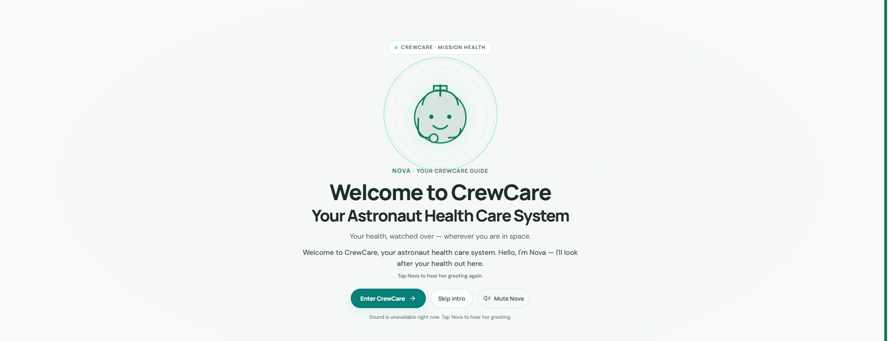
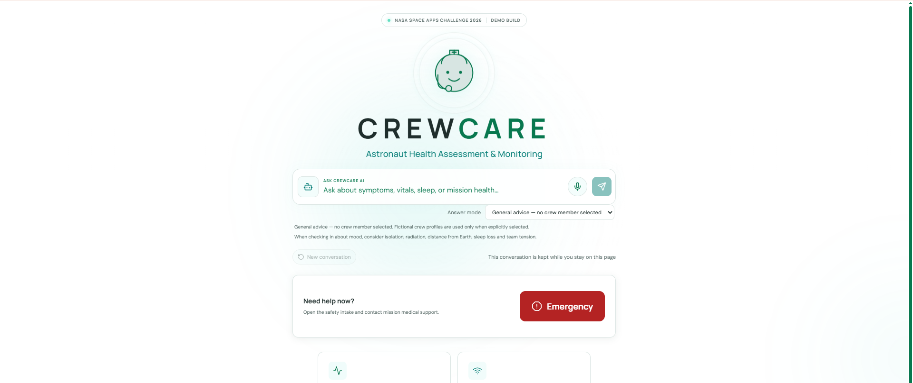
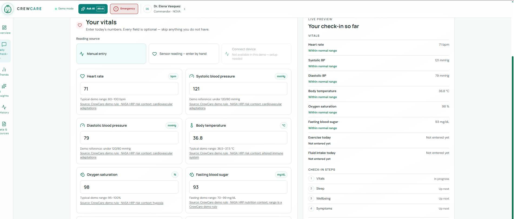
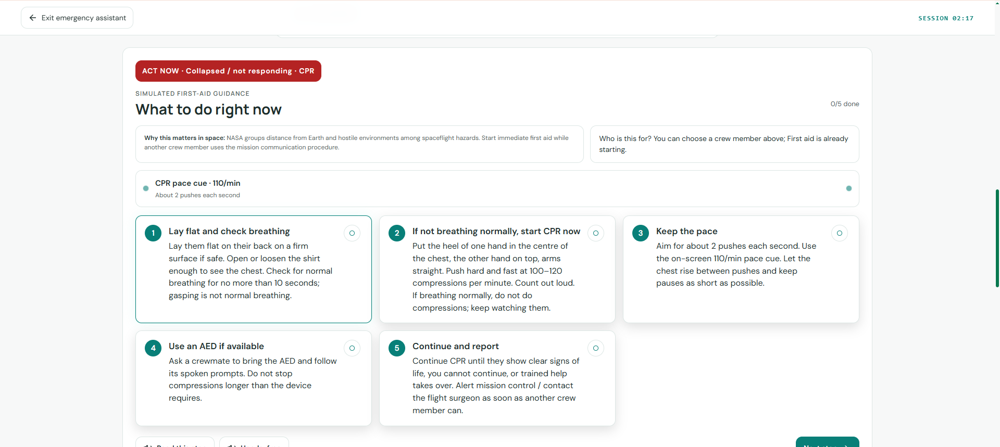
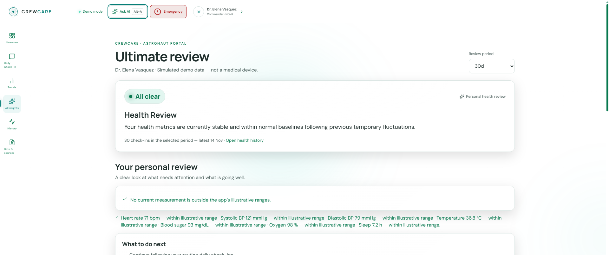
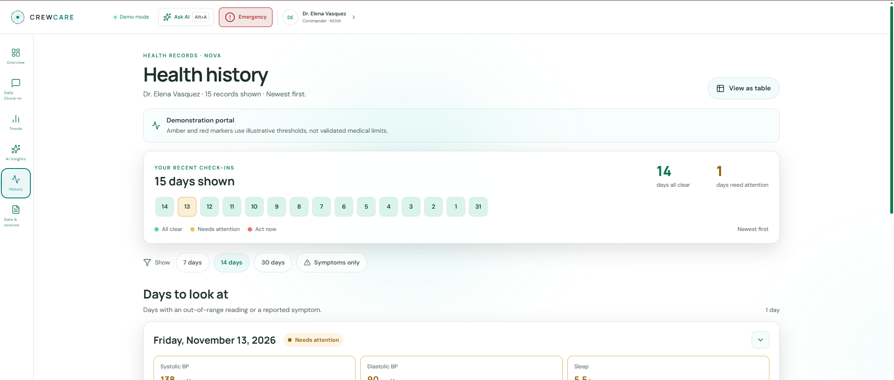

# CrewCare

**Astronaut health monitoring and emergency guidance — NASA Space Apps Challenge 2026**

Team Falak · Local Event: Topi, Pakistan · Challenge: *Create Health Monitoring Software for Astronauts on Space Missions*


**Live demo:** https://crew-care-nasa-space-app-challenge.vercel.app

> All astronaut profiles and health measurements in the demo are fictional and simulated. CrewCare is not a medical device, not a diagnosis, and is not endorsed or medically validated by NASA. The thresholds shown are illustrative examples, not clinical limits.

## The problem

Halfway to Mars, a crewmate feels sharp chest pain and collapses. The nearest doctor is about 140 million miles away, and a radio message takes minutes each way. The crew has to act on their own — and astronauts are not doctors.

CrewCare is built for that moment, and for the weeks before it. It watches each astronaut's health every day, warns early when something drifts the wrong way, and talks the crew through an emergency step by step, hands-free.

## What it does

- **Daily check-in** — heart rate, blood pressure, temperature, blood sugar, oxygen, sleep, mood, plus exercise minutes and water intake. Every field is optional. Each reading gets a plain-words answer: all clear, watch, or act now.
- **Traffic-light assessment** — a rules engine checks each check-in against set limits and against the astronaut's own 30-day normal range, and flags it GREEN, AMBER or RED.
- **Nova, the voice companion** — greets the crew, answers health questions, and reads every emergency step out loud so your hands stay on the patient.
- **Ask CrewCare AI** — answers questions with a live language model (Google Gemini), using the selected astronaut's actual stored readings, with the evidence shown.
- **Emergency mode** — tap a shortcut (chest pain, collapse and CPR, heavy bleeding, and more) or type what happened in plain words, and get a numbered first-aid procedure with pace cues and space-specific notes. Same quality either way.
- **Mission Control** — all four crew members at once, red alerts first, with acknowledgement and handover between officers.
- **Trends and forecast** — 14–30 day charts with a sentence saying whether things are getting better or worse, and a warning when a reading keeps drifting the wrong way.
- **Health history** — every check-in on record, with the days that need attention highlighted.

## Screenshots

### Welcome — Nova greets the crew



### Home — ask anything, or open an emergency



### Daily check-in — your vitals, with a live preview



### Emergency — a numbered procedure with a pace cue



### AI Insights — a plain-words review of the last 30 days



### Health history — 15 days at a glance



## The crew

All four are fictional, with 30 days of simulated history each.

| Astronaut | Callsign | Role | Demo password |
|---|---|---|---|
| Dr. Elena Vasquez | NOVA | Commander · Flight Medicine | `nova123` |
| James Okafor | ATLAS | Mission Specialist · Systems Engineering | `atlas123` |
| Dr. Yuki Tanaka | CIPHER | Mission Specialist · Biomedical Research | `cipher123` |
| Marcos Reyes | VECTOR | Pilot · Aerospace Engineering | `vector123` |

CIPHER currently needs attention (blood pressure and sleep) — open Mission Control to see the alerts.

## How it works

1. An astronaut logs a check-in — or the demo data is already there.
2. The rules engine scores it against Earth-normal reference ranges (heart rate 60–100 bpm, blood pressure below 120/80, temperature 36.5–37.5 °C, fasting blood sugar 70–99 mg/dL, oxygen 95–100%, sleep 7–9 hours) and against the astronaut's own 30-day baseline.
3. Anything out of range becomes an alert — green, amber or red — with a suggested next step.
4. Mission Control sees every alert in one prioritised list.
5. Ask CrewCare AI and Nova answer questions using the stored readings, with sources shown.

The decision rules are the authority. The AI and the statistics are helpers on top. All demo data is simulated and clearly labelled as simulated.

## Tech stack

- **Framework:** Next.js 16 (App Router), React 19, TypeScript
- **Styling:** Tailwind CSS 4
- **Database:** PostgreSQL + Prisma 5 (optional — the demo runs without a database)
- **Validation:** Zod
- **Charts:** Recharts
- **Voice:** Web Speech API (the device's own voice, no paid service)
- **AI:** Google Gemini (`gemini-3.5-flash-lite`) through the app's own API route, with a rule-based fallback when no key is set
- **Hosting:** Vercel

## Quick start (demo mode)

```powershell
npm install
Copy-Item .env.example .env.local
npm run dev
```

Open http://localhost:3000 — pick a demo astronaut, or go to `/mission-control`. No database or AI provider is needed to browse the demo. Check-ins, alert acknowledgements and conversations are saved in the browser.

To use the live AI answers, set `LLM_MODEL=gemini-3.5-flash-lite` and `LLM_API_KEY` in `.env.local` (server-only — never commit `.env`). Without a key, the AI clearly says it is not configured instead of making up an answer.

To run with a database, set `DATABASE_URL` in `.env.local`, then run `npm run db:migrate` and (only in a disposable demo database) `npm run db:seed`.

## Environment variables

| Variable | Purpose |
|---|---|
| `DATABASE_URL` | PostgreSQL connection string for Prisma. Leave as the example placeholder to use the demo data. |
| `LLM_PROVIDER` | Optional provider selector: `openai-compatible`, `openai`, or `gemini`. |
| `LLM_API_KEY` | Optional server-only LLM API key; takes precedence over the legacy variable. |
| `LLM_BASE_URL` | Optional OpenAI-compatible API base URL. Gemini supports this compatibility mode at Google's documented endpoint. |
| `LLM_MODEL` | Optional provider model name. |
| `CREWCARE_AI_API_KEY`, `CREWCARE_AI_BASE_URL`, `CREWCARE_AI_MODEL` | Legacy aliases retained for existing deployments. |
| `NEXTAUTH_URL` | Present in the sample template but unused; no authentication implementation exists. |

Never use real health data until authentication, role-based authorization, provider/privacy review, and secure deployment are implemented.

## NASA data

CrewCare is built on NASA's Human Research Program: the five hazards of human spaceflight, the 17 risks (including SANS — spaceflight-associated neuro-ocular syndrome, the leading spaceflight health risk), and open research data from OSDR.

- 5 Hazards of Human Spaceflight — https://www.nasa.gov/hrp/hazards/
- Risks of Human Spaceflight — https://www.nasa.gov/hrp/risks/
- Ongoing HRP Research in Space — https://www.nasa.gov/hrp/ongoing-hrp-research/
- NASA Open Science Data Repository (OSDR) — https://osdr.nasa.gov/bio/about/alsda.html
- Canadian Space Agency: Monitoring Radiation for Astronaut Health — https://www.asc-csa.gc.ca/eng/news/articles/2026/2026-02-26-monitoring-radiation-astronaut-health.asp

No NASA data is pulled live into the app. The demo data is simulated and modelled on published HRP findings. Nothing here claims NASA endorsement or clinical validation.

## Tests and checks

```powershell
npm test
npm run lint
npx tsc --noEmit
npm run build
```

`npm test` starts a local Next dev server and exercises the demo APIs, including the simulated critical assessment and the unconfigured-AI path. It does not test PostgreSQL, authentication, a live paid AI provider, Python, or complete browser journeys. See [testing.md](docs/testing.md).

## Documentation

- [System overview](docs/system-overview.md)
- [Project audit and feature matrix](docs/project-audit.md)
- [Known limitations and readiness](docs/known-limitations.md)
- [Architecture](docs/ARCHITECTURE.md)
- [Database design](docs/DATABASE_DESIGN.md)
- [API reference](docs/api-documentation.md)
- [Analytics methodology](docs/analytics-methodology.md)
- [AI architecture](docs/ai-architecture.md)
- [AI-first experience and provider setup](docs/ai-first-transformation.md)
- [Emergency assistant safety boundary](docs/emergency-assistant.md)
- [Clinical validation and regulatory readiness plan](docs/clinical-validation-plan.md)
- [Security review](docs/security.md)
- [Deployment instructions](docs/deployment.md)
- [Testing and verification](docs/testing.md)
- [NASA scientific references and data provenance](docs/scientific-references.md)
- [Reproducible demo guide](docs/demo-guide.md)
- [Submission package draft](docs/submission-package.md)
- [Phase plan and known limitations](docs/IMPLEMENTATION_PLAN.md)

## Team

**Team Falak** — NASA Space Apps Challenge 2026, Topi, Pakistan.

## Safety note

CrewCare is decision support, not a doctor, not a diagnosis, and not a medical device. In a real emergency, always follow your training and contact mission medical support as soon as the channel allows.
